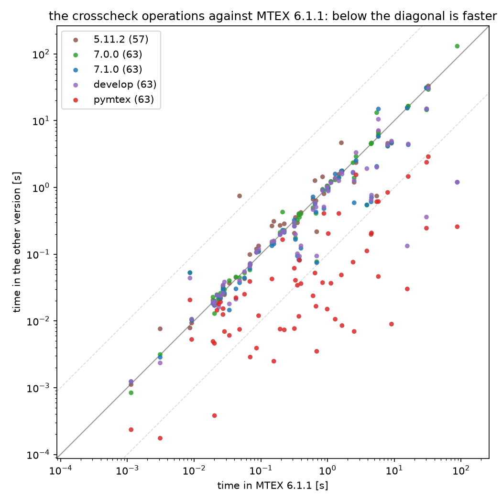

# MTEX versions and pymtex on the crosscheck operations

2026-10-11, bayes (32 cores), each version with its default threading: MATLAB R2024b in batch
mode, one process per module, best of five runs after a warm up (single runs for the long
operations), pymtex the same through `tools/graph/crosscheck.py`. The operations are those of
`bench/*_ops.py`, on the same inputs in every version. Two other users kept about 18 of the 32
cores busy through all runs, the same for every version, so the times are high and the ratios
are what to read. `bench/mtex_versions.py` repeats it: the releases are their GitHub zips with the
mex files of their tag; develop is `../mtexDevelop` at 78bcc0897 (2026-10-09).

## Against MTEX 6.1.1

The ratio of each version's time to 6.1.1's, over the operations both ran:

| version | operations | geometric mean | median | faster | 2x faster | 2x slower |
|---|---:|---:|---:|---:|---:|---:|
| 5.11.2 | 57 | 1.055 | 1.027 | 37 % | 3 | 3 |
| 7.0.0 | 63 | 0.939 | 1.007 | 46 % | 3 | 3 |
| 7.1.0 | 63 | 0.678 | 0.915 | 63 % | 14 | 2 |
| develop | 63 | 0.612 | 0.906 | 67 % | 15 | 1 |
| pymtex | 63 | 0.075 | 0.090 | 98 % | 53 | 1 |

- pymtex is a median eleven times faster than 6.1.1 and faster in 62 of 63 operations; the
  largest gains are the kernel sum of an RBF ODF (1000 times), the Taylor model (500 times) and
  the harmonic form of an RBF ODF (300 times). Its slowest against 6.1.1 are the nearest search in
  an SO(3) grid (0.77) and the S2 interpolation (0.78).
- 7.1.0 and develop gain over 6.1.1 mostly in the maps and the export (KAM 9 times, the HDF5
  export 70 times) and in the Taylor model on develop (125 times); 7.0.0 is 6.1.1's speed but for
  the interpolations, about twice as slow.
- 5.11.2 is 6.1.1's speed overall; the SO(3) interpolation is seven times faster in it, the ODF
  average of a tensor fifteen times slower.
- `maps_smooth_boundary` is `smooth(grains, 5)` in 5.11.2 and 6.1.1, the older algorithm, and
  `smoothBoundary` from 7.0.0 on; its ratios compare two algorithms, which is why every newer
  version, pymtex included, lies above the diagonal there.

## Not run

An operation is left out of a version that cannot run it: the trueEbsd job, the halfwidth
selection, CLASSIX and the 3D maps before the versions that brought them, the EDAX HDF5 reader in
6.1.1, `calcGrains` with its map in 5.11.2. 90 operations ran somewhere, 63 of them in 6.1.1.

## The times, ms

| operation | 5.11.2 | 6.1.1 | 7.0.0 | 7.1.0 | develop | pymtex |
|---|---:|---:|---:|---:|---:|---:|
| `analysis_birefringence` | 20.4 | 19.2 | 22.7 | 18.2 | 19.1 | 4.9 |
| `analysis_classix` | - | - | 3817.4 | 3691.4 | 3632.3 | 621.2 |
| `analysis_cluster` | 982.4 | 1023.1 | 992.8 | 923.5 | 883.0 | 203.5 |
| `analysis_cluster_directions` | 354.9 | 329.9 | 174.5 | 166.2 | 197.6 | 40.6 |
| `analysis_cluster_orientations` | - | - | 477.9 | 475.9 | 1110.6 | 57.1 |
| `analysis_components` | 2357.9 | 2669.2 | 2911.3 | 2527.0 | 3327.9 | 1545.7 |
| `analysis_gbnd` | - | 2407.0 | 2346.4 | 1657.7 | 1691.9 | 76.0 |
| `analysis_gnd` | - | - | 12919.0 | 12807.9 | 1376.2 | 69.9 |
| `analysis_halfwidth_s2_cons` | - | - | - | - | 409.5 | 185.1 |
| `analysis_halfwidth_s2_ucv` | - | - | - | - | 561.8 | 136.8 |
| `analysis_halfwidth_so3_cons` | - | - | - | - | 1041.7 | 382.8 |
| `analysis_halfwidth_so3_ucv` | - | - | - | - | 8271.6 | 462.0 |
| `analysis_odf_max` | 1570.8 | 1474.6 | 1398.1 | 1398.4 | 1258.8 | 406.7 |
| `analysis_optimal_s2` | - | - | 1313.1 | 725.0 | 1808.6 | 358.6 |
| `analysis_optimal_so3` | - | - | 103147.4 | 18045.2 | 54262.0 | 956.6 |
| `analysis_schmid` | 33.4 | 27.1 | 25.7 | 29.1 | 26.0 | 12.5 |
| `embedding_embed_6mmm` | 4601.6 | 4547.8 | 4618.3 | 708.4 | 765.4 | 208.0 |
| `embedding_embed_m3m` | 421.3 | 399.2 | 401.7 | 122.7 | 133.4 | 36.2 |
| `embedding_mean_6mmm` | 4550.3 | 4490.0 | 4499.0 | 607.6 | 649.4 | 198.1 |
| `embedding_mean_m3m` | 389.4 | 379.3 | 358.0 | 82.3 | 93.1 | 81.0 |
| `embedding_project_6mmm` | 16412.7 | 16154.7 | 16557.1 | 4353.1 | 4473.6 | 1458.5 |
| `embedding_project_m3m` | 802.8 | 881.5 | 894.8 | 481.1 | 510.0 | 408.0 |
| `functions_rbf_direct` | 4590.1 | 9074.3 | 4729.4 | 4706.8 | 4938.1 | 9.0 |
| `functions_rbf_harmonic` | 1195.0 | 2500.0 | 1386.6 | 589.3 | 1264.7 | 7.0 |
| `functions_s2_eval` | 18.6 | 22.0 | 24.7 | 24.1 | 24.3 | 14.5 |
| `functions_s2_interpolate` | - | 211.8 | 427.5 | 228.8 | 213.9 | 165.1 |
| `functions_s2_quadrature` | 31.1 | 27.2 | 31.4 | 30.5 | 34.5 | 15.3 |
| `functions_so3_eval` | 42.9 | 57.0 | 52.4 | 44.2 | 54.7 | 25.1 |
| `functions_so3_interpolate` | 742.9 | 5449.3 | 13185.3 | 2066.5 | 2005.1 | 610.6 |
| `functions_so3_quadrature` | 295.3 | 353.3 | 322.5 | 94.1 | 101.6 | 34.2 |
| `geometry_dot_mori_mori2` | 4664.4 | 1608.3 | 1758.1 | 1738.6 | 1683.7 | 48.8 |
| `geometry_dot_mori_mref` | 1441.4 | 841.3 | 937.5 | 908.6 | 897.7 | 37.5 |
| `geometry_dot_ori_ori2` | 133.0 | 92.7 | 111.5 | 109.0 | 119.6 | 12.0 |
| `geometry_dot_ori_ref` | 119.5 | 86.2 | 107.4 | 106.3 | 106.5 | 3.9 |
| `geometry_grid_build` | 7.6 | 3.1 | 3.1 | 2.9 | 2.4 | 0.2 |
| `geometry_grid_nearest` | 22.7 | 24.9 | 25.9 | 21.6 | 23.9 | 19.2 |
| `geometry_grid_radius` | 24.7 | 28.5 | 29.5 | 26.1 | 38.3 | 6.9 |
| `geometry_p2fr_m` | 1054.2 | 986.9 | 1050.1 | 1006.9 | 1016.6 | 15.0 |
| `geometry_p2fr_mori_mori2` | 5856.5 | 5761.6 | 6217.8 | 5808.3 | 10502.6 | 46.3 |
| `geometry_p2fr_mori_mref` | 1221.2 | 1123.3 | 1230.4 | 1180.0 | 1185.1 | 36.7 |
| `geometry_p2fr_ori_ori2` | 285.2 | 224.6 | 227.9 | 212.2 | 221.0 | 7.3 |
| `geometry_p2fr_ori_ref` | 269.5 | 194.3 | 211.2 | 196.9 | 196.1 | 7.5 |
| `geometry_r_s` | 9.3 | 9.2 | 10.5 | 10.3 | 10.6 | 5.3 |
| `geometry_r_v` | 18.5 | 20.2 | 18.2 | 17.1 | 17.4 | 4.6 |
| `io_export_h5` | - | 87594.2 | 130641.9 | 1196.4 | 1199.3 | 257.8 |
| `io_load_1C_1` | 6880.7 | 5773.9 | 6617.6 | 14952.9 | 7112.7 | 614.8 |
| `io_load_ang` | 632.2 | 670.4 | 408.4 | 427.9 | 507.2 | 16.6 |
| `io_load_ang_PAGR` | 33150.5 | 32301.8 | 29300.7 | 30726.7 | 30472.9 | 2888.3 |
| `io_load_ang_SAM` | 4577.5 | 7946.9 | 4136.3 | 4198.5 | 4368.6 | 841.5 |
| `io_load_ctf` | 1263.9 | 647.5 | 578.8 | 565.2 | 586.4 | 52.2 |
| `io_load_dubna` | 205.7 | 318.3 | 289.3 | 261.8 | 263.1 | 7.7 |
| `io_load_h5_edax` | - | - | 1235.5 | 1265.8 | 3155.4 | 398.7 |
| `io_load_h5oina_copper29` | - | 3878.2 | 548.4 | 543.8 | 1913.9 | 111.8 |
| `io_load_osc` | 663.0 | 605.7 | 495.8 | 721.0 | 465.5 | 23.8 |
| `maps3d_calcgrains3d_in100` | - | - | - | 1929.2 | 1848.8 | 875.7 |
| `maps3d_calcgrains3d_sim` | - | - | - | 232.5 | 231.8 | 113.3 |
| `maps3d_kam3d_in100` | - | - | - | - | 1519.2 | 882.9 |
| `maps3d_load_dream3d` | - | - | - | 213.1 | 207.0 | 118.2 |
| `maps3d_load_xnovo` | - | - | - | 307.7 | 316.2 | 68.0 |
| `maps_aspect` | 17.1 | 20.2 | 12.9 | 19.7 | 19.3 | 0.4 |
| `maps_calcgrains` | - | 317.3 | 302.2 | 322.5 | 299.1 | 61.5 |
| `maps_calcgrains_1C_1` | - | 30433.8 | 14527.3 | 14889.9 | 15080.1 | 2377.3 |
| `maps_grod` | 21.1 | 23.5 | 21.3 | 23.5 | 16.1 | 17.9 |
| `maps_kam` | 217.1 | 687.0 | 77.1 | 74.5 | 93.9 | 3.5 |
| `maps_perimeter` | 1.1 | 1.1 | 0.8 | 1.2 | 1.2 | 0.2 |
| `maps_smooth_boundary` | 7.8 | 8.7 | 52.7 | 52.8 | 43.9 | 20.6 |
| `maps_smooth_fill_ferrite` | - | - | 3495.2 | 3476.8 | 4093.2 | 81.8 |
| `maps_smooth_fill_twins` | - | - | 1274.6 | 1289.3 | 2190.7 | 22.7 |
| `maps_smooth_hq_ferrite` | - | - | - | - | 8401.9 | 705.7 |
| `maps_smooth_hq_twins` | - | - | - | - | 7348.1 | 299.0 |
| `maps_smooth_l1tv_ferrite` | - | - | - | - | 7337.2 | 633.5 |
| `maps_smooth_l1tv_twins` | - | - | - | - | 3877.2 | 419.0 |
| `maps_smooth_mean_ferrite` | - | - | 1931.3 | 2115.0 | 1207.5 | 28.0 |
| `maps_smooth_mean_twins` | - | - | 496.5 | 494.3 | 252.7 | 12.5 |
| `maps_smooth_spline_ferrite` | - | - | 6294.5 | 7198.9 | 3306.7 | 56.2 |
| `maps_smooth_spline_twins` | - | - | 1197.7 | 1255.2 | 1193.3 | 20.2 |
| `maps_trueebsd_distortion` | - | - | - | 2581.6 | 2532.9 | 1253.1 |
| `maps_trueebsd_undistort` | - | - | - | 233.7 | 190.8 | 130.1 |
| `plotting_ipf_6mmm` | 69.7 | 69.3 | 70.7 | 71.5 | 72.6 | 2.9 |
| `plotting_ipf_exact_6mmm` | 98.7 | 68.5 | 58.1 | 60.9 | 66.1 | 39.0 |
| `plotting_ipf_exact_m3m` | 264.7 | 146.8 | 145.9 | 133.7 | 153.9 | 42.5 |
| `plotting_ipf_m3m` | 310.1 | 156.6 | 153.5 | 142.3 | 158.0 | 2.5 |
| `tensors_average_odf` | 745.3 | 48.0 | 44.4 | 37.3 | 40.2 | 7.5 |
| `tensors_average_ori` | 1719.0 | 1645.9 | 1775.9 | 1759.9 | 1583.2 | 8.5 |
| `tensors_inv` | 1374.6 | 1300.2 | 1297.8 | 1588.9 | 1355.0 | 10.6 |
| `tensors_rotate` | 390.9 | 371.6 | 404.2 | 82.2 | 85.7 | 11.7 |
| `tensors_taylor` | 15434.5 | 15626.3 | 15742.0 | 15427.2 | 132.7 | 30.1 |
| `tensors_taylor_fun` | 31383.4 | 30253.4 | 30877.2 | 30796.5 | 359.8 | 245.2 |
| `tensors_velocity` | 44.9 | 42.4 | 45.6 | 30.2 | 21.2 | 22.2 |
| `tensors_youngs` | 36.8 | 33.8 | 40.2 | 14.5 | 18.0 | 6.1 |
